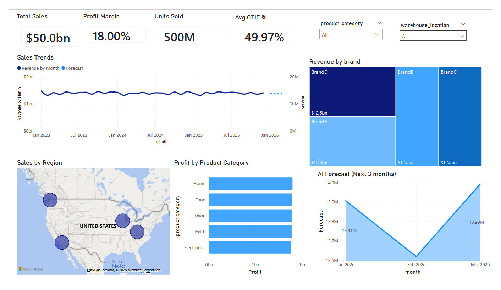
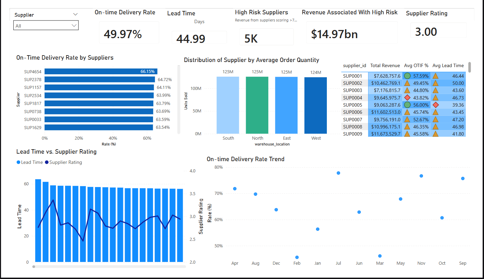
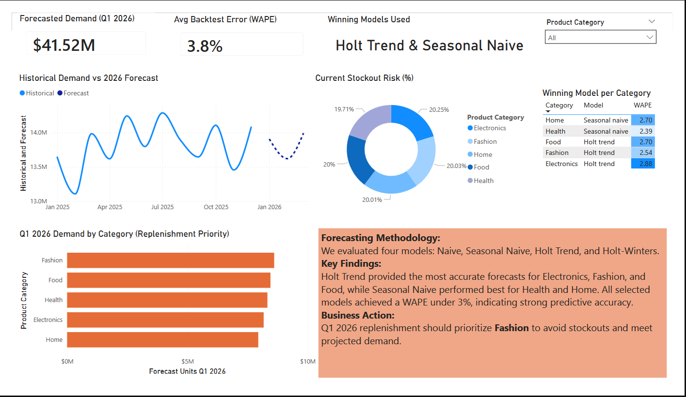
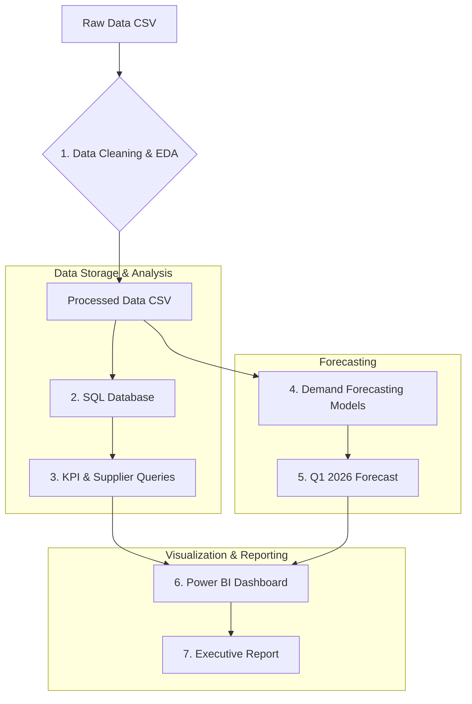

# Supply Chain Analytics & Demand Forecasting


## 1. Project Overview

This project delivers an end-to-end data analytics solution for a simulated retail supply chain. The goal is to provide actionable insights into operational efficiency, supplier performance, and future product demand to support data-driven decision-making.

The project simulates a real-world business scenario where a data analyst is tasked with:

- Cleaning and preparing raw supply chain data.
- Engineering key performance indicators (KPIs) to monitor business health.
- Analyzing supplier and warehouse performance to identify risks.
- Developing a forecasting model to predict future demand for different product categories.
- Building interactive dashboards and executive reports to communicate findings to stakeholders.

## 2. Business Problem & Objectives

The retail supply chain faces challenges in inventory management, supplier reliability, and demand uncertainty. This can lead to stockouts, excess inventory, and lost revenue. The primary objective of this project is to build a robust analytics framework to address these challenges.

**Key business questions addressed:**

- What is the overall financial and operational health of the supply chain?
- Which warehouses are most at risk of stockouts?
- Which suppliers are underperforming, and what is the revenue at risk?
- Which product categories are most profitable and which require the most replenishment?
- What is the projected demand for each product category in Q1 2026 to guide inventory planning?

## 3. Dashboard Preview

- **Executive Overview:**
  - 
  - _Caption: The main dashboard shows total sales, profit margin, OTIF rates, and a breakdown of key metrics._

- **Supplier Performance:**
  - 
  - _Caption: This section visualizes supplier ratings, lead times, and revenue contribution to identify risks._

- **Demand Forecasting:**
  - 
  - _Caption: This section visualize demand forecast and the inventory._

## 4. Key Findings & Business Recommendations

### 4.1 Operational Insights (from SQL & Power BI)

- **Inventory Risk:** The overall OTIF (On-Time, In-Full) rate is `49.97%`, a critical area for improvement. The dashboard shows a significant percentage of records are below the reorder level, particularly in certain warehouses.
- **Supplier Concentration:** A Pareto analysis reveals that a small number of suppliers account for a large portion of total revenue. A high disruption risk from these top suppliers poses a significant threat. The dashboard highlights suppliers like `SUP4654` with on-time delivery rates below `66.15%` for urgent review.
- **Profitability:** The "Fashion" and "Food" categories contribute the most to revenue, while the weighted profit margin is approximately `18%`. The `Food` category, however, carries the highest average operational risk score.

### 4.2 Demand Forecasting Insights (from Python)

The demand forecasting analysis evaluated several models, with a key finding being that the optimal model varies by product category.

- **Best Models:** Based on rolling-origin backtesting, **Holt's Linear Trend** was the most accurate for Electronics, Fashion, and Food, while **Seasonal Naive** performed best for Health and Home. All selected models achieved a low Weighted Absolute Percentage Error (WAPE) under **3%**.
- **Business Action:** For Q1 2026, the model forecasts the highest demand for the **Fashion** category. Therefore, replenishment and inventory strategies should prioritize Fashion to avoid potential stockouts and meet projected consumer demand.

## 5. Project Architecture & Workflow

This project follows a complete data pipeline, from raw data to actionable insights.



## 6. Technical Stack & Methodology

- **Data Cleaning & Feature Engineering (Python):**
  - **Libraries:** `pandas`, `numpy`, `scikit-learn`, `statsmodels`.
  - **Methodology:** Raw data is loaded, cleaned (no duplicates/missing values found), and enriched with engineered features such as `Profit_Margin`, `OTIF_Flag`, `Inventory_Status`, and `Delivery_Delay_Days`.

- **Data Modeling & KPIs (SQL):**
  - **Database:** MySQL.
  - **Methodology:** A `supply_chain` view provides a clean, analytics-ready layer. Complex queries in `02_kpi_queries.sql` and `03_supplier_perf.sql` are used to calculate key metrics, including stockout risks, supplier performance rankings, financial summaries, and Pareto analysis for supplier revenue concentration.

- **Demand Forecasting (Python):**
  - **Models Evaluated:** Naive, Seasonal Naive, Holt's Linear Trend, and Holt-Winters' Seasonal Method.
  - **Methodology:** A rolling-origin backtest was performed to select the best-performing model for each of the five product categories, minimizing Mean Absolute Error (MAE) and WAPE.

- **Visualization & Dashboarding (Power BI):**
  - **Methodology:** The Power BI dashboard (`Supply_Chain_Dashboard.pbix`) connects to the SQL views to create an interactive experience. It allows stakeholders to monitor executive KPIs, investigate supplier performance, track warehouse health, and view the final demand forecasts for Q1 2026.

## 7. How to Use This Repository

1.  **Clone the repository:**

    ```bash
    git clone https://github.com/BrokerRecord/Supply-Chain-Analytics.git
    ```

2.  **Navigate to the directory:**

    ```bash
    cd Supply-Chain-Analytics
    ```

3.  **Set up the environment (recommended):**

    ```bash
    python -m venv .venv
    source .venv/bin/activate  # On Windows, use `.venv\Scripts\activate`
    pip install -r requirements.txt
    ```

4.  **Run the Notebooks:**
    - Run `notebooks/01_data_cleaning.ipynb` to process the raw data.
    - Run `notebooks/02_demand_forecasting.ipynb` to generate forecasts and evaluate models.

5.  **Set up the Database:**
    - Execute the SQL scripts in the `sql/` directory against a MySQL instance. Ensure the CSV file path in `01_create_tables.sql` is updated to your local path.

6.  **View the Dashboard:**
    - Open `powerBI/Supply_Chain_Dashboard.pbix` in Power BI Desktop and refresh the data connections.

## 8. Folder Structure

```
Supply-Chain-Analytics/
│
├── data/
│   ├── raw/                    # Original raw dataset (CSV)
│   └── processed/              # Cleaned and feature-engineered data
│
├── sql/
│   ├── 01_create_tables.sql
│   ├── 02_kpi_queries.sql
│   └── 03_supplier_perf.sql
│
├── notebooks/
│   ├── 01_data_cleaning.ipynb
│   └── 02_demand_forecasting.ipynb
│
├── powerBI/
│   ├── Supply_Chain_Dashboard.pbix
│   └── Dashboard_Screenshots/
│
├── reports/
│   └── Operational_Report.pdf
│
└── README.md
```

## 9. Future Scope & Limitations

- **Forecasting:** The forecasts are at a category level. A future extension could focus on SKU-level forecasting, which is more complex but necessary for operational decisions. Incorporating external factors like promotions and holidays would improve model accuracy.
- **Dashboard:** The report can be extended to include forecast confidence intervals and inventory optimization recommendations .
- **Data:** The analysis is based on a 3-year historical dataset. Longer-term data would provide more robust seasonal insights.

---

## Author

- **[Awa Mbaye]**
- **LinkedIn:** [Awa Mbaye](https://www.linkedin.com/in/awa-mbaye-4930a328b/)
- **GitHub:** [@BrokerRecord](https://github.com/BrokerRecord)

---
